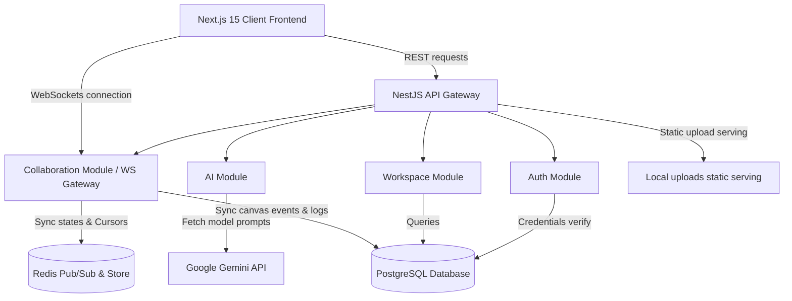

# Architecture Diagram

This document details the high-level system components and communication channels inside the Aether collaborative workspace monorepo.

## System Topology

## Description of Channels

1. **REST APIs**: Used for landing operations, registers, login verification, listing workspaces, listing comment threads, loading snapshots, and uploading files.
2. **WebSocket Channels**: Live connection layer on port `3001` mapping cursors, typing changes, selection markers, Yjs conflict resolution messages, and canvas mutations in real-time.
3. **Redis Store**: Tracks live socket user connections, handles WebSocket event broadcasts across gateway channels, and caches ephemeral user positions.
4. **PostgreSQL Database**: Persistent storage for all entities, organization keys, canvas event history tables, versions updates, and notifications logs.
