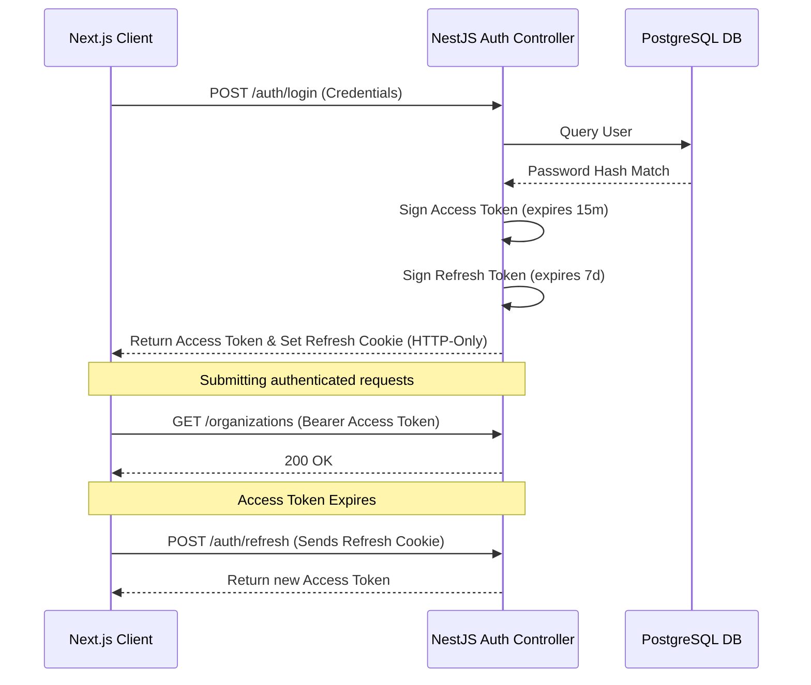

# Authentication Flow

This document details the security and lifecycle flow of tokens inside Aether.

## Flow Mechanics

## Security Toggles
1. **HTTP-Only Cookies**: Refresh tokens are stored in secure cookies preventing XSS accesses.
2. **Access Token Lifetimes**: Short 15-minute expirations restrict replay attacks.
3. **Silent Refresh Interceptor**: The client REST utility intercepts `401 Unauthorized` responses, calls `/auth/refresh` in the background, and retries the original request seamlessly.
